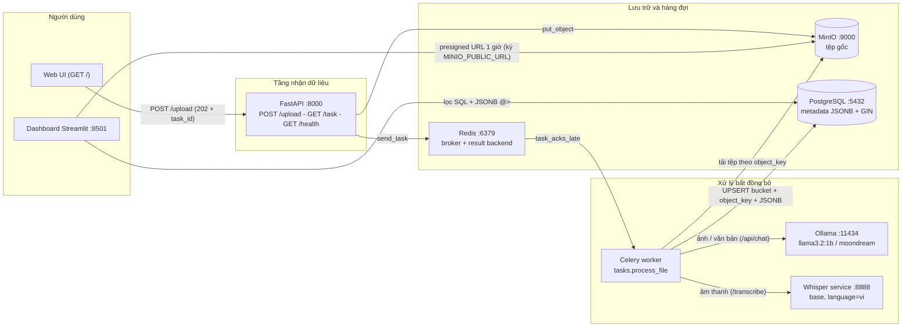

# Multimodal AI Ingestion Pipeline

Pipeline xử lý dữ liệu đa phương thức chạy hoàn toàn **local trên Docker** — nhận ảnh, âm thanh và văn bản qua API, tự động phân loại/mô tả/chuyển ngữ bằng AI, lưu trữ có tổ chức và tra cứu qua dashboard. Điểm nhấn: **toàn bộ chạy được trên laptop CPU-only**, không cần GPU.

> Ngôn ngữ: **Tiếng Việt** | [English](README.md)

---

## Mục lục

1. [Dự án này làm gì?](#1-dự-án-này-làm-gì)
2. [Tính năng chính](#2-tính-năng-chính)
3. [Kiến trúc hệ thống](#3-kiến-trúc-hệ-thống)
4. [Luồng xử lý một tệp](#4-luồng-xử-lý-một-tệp)
5. [Công nghệ sử dụng](#5-công-nghệ-sử-dụng)
6. [Các dịch vụ và cổng](#6-các-dịch-vụ-và-cổng)
7. [Khởi động nhanh](#7-khởi-động-nhanh)
8. [Cấu hình](#8-cấu-hình)
9. [API](#9-api)
10. [Điểm nhấn kỹ thuật](#10-điểm-nhấn-kỹ-thuật)
11. [Kiểm thử](#11-kiểm-thử)
12. [Hạn chế hiện tại](#12-hạn-chế-hiện-tại)
13. [Lộ trình phát triển](#13-lộ-trình-phát-triển)

---

## 1. Dự án này làm gì?

Đây là một pipeline nhận dữ liệu đầu vào ở **ba dạng**: ảnh (JPEG/PNG/WEBP), âm thanh và văn bản/JSON, sau đó dùng mô hình AI chạy cục bộ để tạo ra **metadata có cấu trúc**: nhãn phân loại (`labels`), mô tả chi tiết (`detail`), nhãn ngắn (`short_label`) và độ tin cậy (`confidence`). Kết quả lưu trong PostgreSQL dưới dạng JSONB, tệp gốc lưu trong MinIO, và có sẵn dashboard Streamlit để tìm kiếm, lọc và tải lại tệp gốc.

Dự án được xây dựng như một **baseline portfolio**: thể hiện trọn vẹn một hệ thống bất đồng bộ thực chiến (API → hàng đợi → worker → AI → cơ sở dữ liệu → dashboard) kèm các bài học vận hành thật: xử lý lỗi, retry có phân loại, migration dữ liệu cũ, chữ ký presigned URL, và bộ kiểm thử 56 case.

**Ba nhánh xử lý AI:**

| Loại tệp | Mô hình mặc định | Nhiệm vụ |
| --- | --- | --- |
| Ảnh | `moondream` (vision, ~1.7 GB) | Mô tả nội dung, trích nhãn, đối tượng, bối cảnh |
| Âm thanh | Whisper `base`, `language=vi` | Chuyển ngữ tiếng Việt thành văn bản rồi tóm lược/phân loại |
| Văn bản / JSON | `llama3.2:1b` (~1.3 GB) | Tóm tắt, trích nhãn chủ đề, phân loại nội dung |

## 2. Tính năng chính

- **Upload đa phương thức**: qua web UI tích hợp sẵn (`/`) hoặc `POST /upload`; API trả 202 kèm `task_id` để theo dõi tiến độ.
- **Xử lý bất đồng bộ**: Celery + Redis tách tầng nhận file khỏi tầng AI, API không bao giờ bị chặn bởi tác vụ nặng.
- **Tìm kiếm mạnh**: dashboard lọc ngay trong SQL (`ILIKE` cho từ khoá, toán tử containment `@>` trên JSONB dùng sẵn chỉ mục GIN) thay vì lọc trong Python.
- **Tải file gốc an toàn**: cột "Tệp" trong dashboard dùng presigned URL hết hạn sau 1 giờ, không lộ credentials.
- **Chống lỗi người dùng**: dò MIME theo magic bytes của nội dung (không tin header client), ảnh chỉ nhận JPEG/PNG/WEBP, chặn sớm request quá hạn mức ngay tầng HTTP.
- **Chịu lỗi có chủ đích**: lỗi vĩnh viễn (sai định dạng, thiếu model) thất bại ngay; lỗi tạm thời (timeout, 5xx, mất kết nối) tự retry tối đa 2 lần, cách nhau 30 giây.
- **Tự khởi tạo model**: service `ollama-init` tự pull model lần đầu chạy; API và worker chờ xong mới nhận việc, không bao giờ fail 404 "model not found".
- **Tối ưu cho laptop CPU-only**: model mặc định nhẹ, Ollama chỉ giữ 1 model trong RAM, `keep_alive` ngắn, Redis giới hạn 256 MB, `torch` bản CPU thuần.
- **Migration cho dữ liệu cũ**: `migrate_legacy.sql` nâng cấp database schema cũ sang lưu `bucket` + `object_key`, giữ nguyên dữ liệu lịch sử, chạy được nhiều lần (idempotent).

## 3. Kiến trúc hệ thống



**Vì sao tách vậy?** API chỉ làm ba việc: kiểm tra đầu vào, lưu tệp, đẩy việc vào hàng đợi — nhờ đó luôn phản hồi nhanh. Mọi công việc nặng (gọi LLM, chuyển ngữ) nằm ở worker; worker chết giữa chừng thì task được giao lại cho worker khác (`task_acks_late` + `task_reject_on_worker_lost`), không mất việc.

## 4. Luồng xử lý một tệp

1. **Nhận file** — client upload qua `POST /upload` (hoặc kéo-thả trên web UI). Middleware chặn ngay nếu `Content-Length` vượt hạn mức (50 MB tổng, 10 MB cho ảnh).
2. **Dò định dạng thật** — đọc magic bytes bằng thư viện `filetype`; nếu không nhận ra thì dựa vào đuôi file; cuối cùng mới tin header client. Ảnh ngoài whitelist (JPEG/PNG/WEBP) bị từ chối 415 trước khi tốn tài nguyên.
3. **Lưu tệp gốc** — đặt vào MinIO bucket `uploads` với key là `{task_id}{đuôi_file}`.
4. **Đẩy vào hàng đợi** — `send_task("tasks.process_file", task_id=task_id)`; nếu Redis lỗi sau khi file đã lưu, API **xóa file vừa lưu** (rollback) và trả 503 — không để lại tệp mồ côi.
5. **Worker tải file** và định tuyến theo MIME:
   - *Ảnh*: thu nhỏ về cạnh dài ~1024 px (giữ nguyên định dạng, tự xoay theo EXIF), mã hóa base64, gửi kèm prompt cho vision model qua `/api/chat`.
   - *Âm thanh*: gọi Whisper service `/transcribe` (tiếng Việt), văn bản chuyển ngữ được cắt còn 12.000 ký tự rồi gửi cho text model.
   - *Văn bản/JSON*: cắt còn 12.000 ký tự, gửi cho text model.
6. **AI trả kết quả JSON** — hướng dẫn nằm ở system message, nội dung file ở user message (hạ thấp rủi ro prompt injection); `num_ctx=8192` đặt rõ ràng để tiếng Việt "tốn token" không bị cắt ngầm.
7. **Lưu metadata** — UPSERT vào bảng `metadata`: `bucket` + `object_key` (không lưu URL nội bộ), `labels`, `short_label`, `confidence`, `detail` (JSONB).
8. **Tra cứu** — client hỏi `GET /task/{task_id}` (trạng thái: `queued` → `processing` → `finished`/`failed`), hoặc mở dashboard để tìm kiếm, xem kết quả, tải file gốc qua presigned URL.

## 5. Công nghệ sử dụng

| Thành phần | Công nghệ | Phiên bản | Vai trò |
| --- | --- | --- | --- |
| API | FastAPI + Uvicorn | 0.115.0 / 0.30.1 | Nhận upload, tra cứu trạng thái, health check |
| Hàng đợi | Celery + Redis | 5.3.4 / 7-alpine | Xử lý bất đồng bộ, broker + result backend |
| Object storage | MinIO (image từ quay.io) | RELEASE.2024-08-17 | Lưu tệp gốc, sinh presigned URL |
| Cơ sở dữ liệu | PostgreSQL + JSONB/GIN | 15-alpine | Metadata có cấu trúc, tìm kiếm nhanh |
| LLM / Vision | Ollama — `llama3.2:1b`, `moondream` | latest | Phân tích văn bản và ảnh, chạy cục bộ |
| Chuyển ngữ | OpenAI Whisper + torch CPU | 20250625 / 2.9.1+cpu | Speech-to-text tiếng Việt |
| Dashboard | Streamlit + pandas | ≥1.54.0 | Tra cứu, tìm kiếm, tải tệp |
| Tiện ích | filetype, Pillow | 1.2.0 / 11.3.0 | Dò MIME theo magic bytes, thu nhỏ ảnh |
| Kiểm thử | pytest, httpx, pgserver | ≥8.0 | 56 test đơn vị + tích hợp |

## 6. Các dịch vụ và cổng

Tất cả cổng đều gắn vào `127.0.0.1` (không lộ ra mạng ngoài).

| Dịch vụ | Cổng | Địa chỉ truy cập | Ghi chú |
| --- | --- | --- | --- |
| `api` | 8000 | http://localhost:8000 | Web UI tại `/`, tài liệu tự sinh tại `/docs` |
| `dashboard` | 8501 | http://localhost:8501 | Tra cứu + tải tệp (presigned URL) |
| `minio` | 9000 / 9001 | http://localhost:9001 | 9001 là console quản trị |
| `postgres` | 5432 | — | DB `pipeline`, user `pipeline_user` |
| `redis` | — | — | Chỉ dùng nội bộ giữa các container |
| `ollama` | 11434 | http://localhost:11434 | Có thể gọi trực tiếp để thử model |
| `whisper` | 8888 | — | Chỉ dùng nội bộ; model cache trong volume |
| `clawbot` | — | — | Bot demo, chỉ chạy khi bật profile `demo` |

## 7. Khởi động nhanh

**Yêu cầu:** Docker Desktop kèm Docker Compose v2. Cấu hình mặc định dành cho máy **CPU-only, còn trống ~6 GB RAM**; máy 16 GB+ có thể nâng model qua `.env`. Cần vài GB đĩa cho image và model.

```bash
# 1. Tạo file môi trường — hai mật khẩu là BẮT BUỘC
cp .env.example .env
# sửa MINIO_ROOT_PASSWORD và POSTGRES_PASSWORD thành giá trị ngẫu nhiên dài

# 2. Chạy toàn bộ hệ thống (lần đầu sẽ tải model AI, theo dõi bằng logs)
docker compose up --build -d
docker compose logs -f ollama-init     # đợi dòng "Models sẵn sàng."

# 3. Kiểm tra sức khoẻ hệ thống (báo cả MinIO lẫn Redis)
curl http://localhost:8000/health

# 4. Thử upload
#    - Mở http://localhost:8000 và kéo-thả một file .txt nhỏ
#    - Xem kết quả tại http://localhost:8501
#    - Thử ảnh, sau đó mới thử âm thanh (đợi whisper tải xong model:
#      docker compose logs -f whisper)

# 5. (Tuỳ chọn) chạy bot demo tạo dữ liệu liên tục
docker compose --profile demo up -d clawbot
```

Nâng cấp từ database schema cũ: sao lưu rồi chạy
`docker compose exec -T postgres psql -U pipeline_user -d pipeline < migrate_legacy.sql`.

## 8. Cấu hình

Sao chép `.env.example` thành `.env`. Compose sẽ **từ chối khởi động** nếu thiếu hai biến mật khẩu — không còn giá trị dự phòng ai cũng biết.

**Biến quan trọng:**

| Biến | Mặc định | Ý nghĩa |
| --- | --- | --- |
| `MINIO_ROOT_PASSWORD` | *(bắt buộc)* | Mật khẩu MinIO |
| `POSTGRES_PASSWORD` | *(bắt buộc)* | Mật khẩu PostgreSQL |
| `OLLAMA_TEXT_MODEL` | `llama3.2:1b` | Model xử lý văn bản |
| `OLLAMA_VISION_MODEL` | `moondream` | Model xử lý ảnh |
| `OLLAMA_NUM_CTX` | `8192` | Cửa sổ ngữ cảnh LLM (tiếng Việt tốn token) |
| `WHISPER_MODEL` | `base` | Kích thước Whisper |
| `WHISPER_LANGUAGE` | `vi` | Ngôn ngữ chuyển ngữ (để rỗng để tự dò) |
| `MAX_IMAGE_SIZE` | `10485760` | Giới hạn ảnh (bytes) trước khi base64 |
| `MINIO_PUBLIC_URL` | `localhost:9000` | Địa chỉ **trình duyệt** dùng để tải presigned URL |
| `API_KEY` | *(rỗng = tắt)* | Bật xác thực `X-API-Key` cho `/upload` |

**Model mặc định cho laptop CPU và lựa chọn nâng cấp:**

| Thành phần | Mặc định (CPU) | Nâng cấp cho máy mạnh hơn |
| --- | --- | --- |
| Text | `llama3.2:1b` (~1.3 GB) | `llama3.2:3b`, `qwen2.5:3b` |
| Vision | `moondream` (~1.7 GB) | `llava:7b`, `qwen2.5vl:3b`, `gemma3:4b` |
| Whisper | `base` (nhanh, yếu tiếng Việt) | `small` (tiếng Việt tốt hơn, chậm hơn) |
| Ollama | 1 model trong RAM, 1 request song song, `keep_alive=5m` | Tăng qua `.env` |

Lưu ý `MINIO_PUBLIC_URL`: presigned URL được ký theo cơ chế SigV4, **tính cả Host header**, nên phải ký ngay bằng địa chỉ mà trình duyệt sẽ gọi. Đổi hostname sau khi ký sẽ làm hỏng chữ ký. Mặc định đúng khi mở dashboard từ chính máy chạy Docker; xem từ máy khác thì đặt thành IP/hostname của máy Docker.

## 9. API

| Method | Đường dẫn | Mô tả |
| --- | --- | --- |
| `POST` | `/upload` | Nhận file, trả **202** kèm `task_id`, `bucket`, `object_key`, `mime_type` |
| `GET` | `/task/{task_id}` | Trạng thái: `queued` / `processing` / `retrying` / `finished` / `failed`; **404** nếu id chưa từng tồn tại |
| `GET` | `/health` | Trạng thái MinIO **và** Redis; 503 nếu một trong hai lỗi |
| `GET` | `/` | Web UI upload (không cần cài gì thêm) |
| `GET` | `/docs` | Tài liệu OpenAPI tự sinh, thử API trực tiếp trên trình duyệt |

Ví dụ:

```bash
# Upload
curl -F "file=@menu.png" http://localhost:8000/upload
# => {"status":"accepted","task_id":"5f0c...","mime_type":"image/png", ...}

# Theo dõi
curl http://localhost:8000/task/5f0c...
# => {"status":"finished","result":{"short_label":"thực đơn","labels":[...], ...}}
```

## 10. Điểm nhấn kỹ thuật

Những quyết định thiết kế đáng chú ý nhất của dự án (chi tiết đầy đủ trong [README.md](README.md)):

- **Bảo mật đầu vào**: dò MIME bằng magic bytes, không tin header client; ảnh whitelist JPEG/PNG/WEBP — SVG/HEIC/TIFF bị chặn 415 trước khi tới vision model; ảnh quá 10 MB bị từ chối; chặn sớm ở tầng HTTP trước khi đọc body.
- **Presigned URL đúng cách**: dashboard ký bằng `MINIO_PUBLIC_URL` (endpoint trình duyệt gọi được) thay vì hostname nội bộ `minio:9000`; region ghim cứng để chữ ký là phép tính thuần cục bộ.
- **Không để tệp mồ côi**: Redis lỗi sau khi object đã lưu → API tự xóa object và trả 503 kèm thông báo "upload rolled back".
- **Retry có phân loại**: `PermanentTaskError` cho lỗi retry không bao giờ sửa được (HTTP 400/404/413/415/422, S3 `NoSuchKey`/`NoSuchBucket`, ảnh hỏng); lỗi tạm thời (timeout, 429/5xx, mất kết nối) retry tối đa 2 lần, delay 30 giây.
- **Celery an toàn**: `task_acks_late` + `task_reject_on_worker_lost` + `worker_prefetch_multiplier=1` — worker chết giữa chừng thì task được giao lại, không mất việc; API tách `celery_app` khỏi `tasks.py` để không kéo psycopg2 vào process API.
- **Connection pool lười (lazy)**: pool PostgreSQL chỉ tạo khi worker xử lý task đầu tiên, có khoá chống đua và reset khi prefork sinh process con — `--concurrency > 1` an toàn, API khởi động được trước cả khi Postgres lên.
- **Giảm rủi ro prompt injection**: hướng dẫn ở system message, nội dung (không tin cậy) ở user message; `num_ctx` đặt tường minh, `keep_alive` cân bằng giữa giữ model nóng và tiết kiệm RAM.
- **Migration tôn trọng dữ liệu cũ**: `migrate_legacy.sql` backfill `bucket`/`object_key` từ `file_url`, sau đó chỉ **bỏ ràng buộc NOT NULL** của `file_url` (giữ nguyên cột và dữ liệu lịch sử), chạy lặp lại an toàn; đã kiểm chứng trên schema cũ thật (`task_id UUID`, `file_url NOT NULL`).
- **Mật khẩu bắt buộc**: compose dùng `${VAR:?thông báo}` — quên đặt mật khẩu là không chạy, chặn luôn kiểu "vận hành bằng mật khẩu mặc định".

## 11. Kiểm thử

56 test, chạy bằng:

```bash
pip install -r requirements-dev.txt -r requirements-api.txt -r requirements-worker.txt
python -m pytest tests/ -v
```

Phạm vi phủ:

| Nhóm | Nội dung |
| --- | --- |
| Unit | `parse_json_object`, `as_string_list`, pool lười không mở kết nối lúc import, thu nhỏ ảnh giữ đúng định dạng, payload `/api/chat` đúng hệ message |
| API | dò MIME / giới hạn kích thước / whitelist ảnh (MinIO + Celery giả), rollback khi Redis lỗi, 503 khi MinIO lỗi, health báo đúng dịch vụ hỏng, 404 cho task id lạ, `X-API-Key` bật/tắt |
| Dashboard | lọc SQL, presigned URL ký đúng bằng endpoint công khai |
| Tích hợp | worker ghi thật vào PostgreSQL (`pgserver`), migration chạy trên schema cũ thật, chạy 2 lần để chứng minh idempotent |
| Clawbot | chấp nhận 202, gửi đúng `X-API-Key` |

## 12. Hạn chế hiện tại

- Chỉ nhận ảnh JPEG/PNG/WEBP, âm thanh, văn bản thuần và JSON. Chưa có PDF/OCR và video.
- `confidence` cho phép rỗng — không tuyên bố là điểm tin cậy đã hiệu chuẩn.
- Văn bản bị cắt ở 12.000 ký tự; chia nhỏ tệp lớn (chunking) chưa làm.
- `llama3.2` thiên tiếng Anh (tiếng Việt không nằm trong danh sách ngôn ngữ chính thức); `whisper base` yếu tiếng Việt. Nên tự đánh giá trên 50–100 mẫu thật trước khi tin kết quả.
- Task đã xong nhưng kết quả Celery hết hạn (24 giờ) sẽ hiện lại là `queued` dù tệp gốc vẫn còn.
- `mini_clawbot.py` sinh văn bản giả lập — là bot demo, **không phải crawler thật**.
- Đây là baseline phát triển/portfolio: trước khi chạy công khai cần thêm TLS, quản lý secret thật, rate limiting và giám sát.

## 13. Lộ trình phát triển

1. ~~Test đơn giản cho parsing, MIME, migration~~ — **xong, 56 test**.
2. Integration test với Redis/MinIO thật (testcontainers); smoke test upload cả ba định dạng.
3. Idempotency key, bảng trạng thái task (phân biệt chắc chắn "chưa tồn tại" với "kết quả hết hạn"), dead-letter queue.
4. Xác thực đầy đủ (JWT, phân quyền theo endpoint), rate limiting.
5. Data engineering: báo cáo kiểm chứng đầu vào, ETL, dashboard chất lượng dữ liệu.
6. AI engineering: bộ đánh giá 50–100 mẫu thật, so sánh 2–3 model text/vision, sau đó chunking/embedding/RAG.
7. Observability: log có cấu trúc, metric Prometheus/Grafana, tracing.
8. Chuẩn hoá portfolio: tài liệu tiếng Anh, sơ đồ kiến trúc, video demo.
